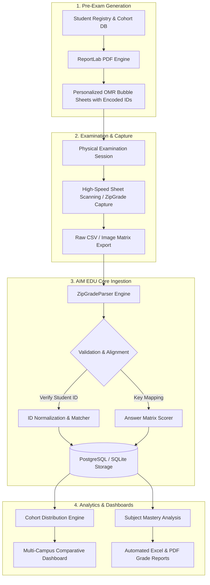

<div align="center">
  
</div>

<div align="center">

# 🎓 AIM EDU &mdash; Automated Examination & Academic Analytics Platform

**High-throughput OMR optical exam scoring, multi-campus cohort analytics, and automated academic reporting system.**

[](https://www.python.org/)
[](https://www.djangoproject.com/)
[](https://opencv.org/)
[-success?style=for-the-badge)](https://github.com/Nekono3/AIM_EDU)

</div>

---

## 📌 Executive Summary

**AIM EDU** is an enterprise-grade academic assessment and cohort analytics platform engineered for the **AALAM educational network**. It bridges physical examination sheets and real-time digital analytics by combining:
1. **Subpixel Bubble Sheet Processing:** Automated OMR ingestion, student identification extraction, and question-level scoring.
2. **Multi-Campus Governance:** Unified role-based management across **6 independent school campuses**.
3. **Deep Cohort Analytics:** Automated generation of percentile distributions, subject difficulty matrices, student trajectory curves, and administrative Excel/PDF exports.

> 📊 **Proven Scale in Production:** Successfully evaluated **20,000+ physical student examination papers** across 6 school campuses with zero data loss and automated multi-lingual reporting (Kyrgyz, Russian, English).

---

## 🏗 System Architecture & Pipeline Flow

The following diagram illustrates the lifecycle of an examination within AIM EDU:



---

## 🚀 Key Modules & Capabilities

### 1. High-Precision OMR & Ingestion (`zipgrade/utils.py`)
- **Robust File Handling:** Dual-mode parser supporting raw CSV and native binary XLSX streams (`openpyxl` with read-only streaming for minimal memory footprint).
- **Dynamic Header Normalization:** Auto-resolves variations in scanner column labels (`ExternalId`, `ZipGrade ID`, `StudentId`, `EarnedPts`, `Score`).
- **Student ID Sanitization:** Validates numeric length, zero-padding, and cross-references student roster databases.

### 2. Multi-Campus Architecture (`schools/` & `accounts/`)
- Campus-isolated permissions: Teachers access classroom cohorts, Head of Academics oversees campus-level trends, and Superadmins review network-wide metrics.
- Complete audit logs and multi-lingual UI/error localization (`locale/`).

### 3. Subject-Level Cognitive Analytics (`analytics/` & `exams/`)
- Aggregates difficulty coefficients per test question to detect flawed questions or unmastered curriculum units.
- Calculates Mean, Median, Standard Deviation, and Top-Quartile benchmarks per school campus.

---

## 💻 Tech Stack

| Domain | Technology | Rationale |
| :--- | :--- | :--- |
| **Backend Framework** | **Django 4.2+ (Python 3.10+)** | Robust ORM, built-in security, role-based admin, enterprise stability |
| **Data & Spreadsheet Engine** | **Pandas, OpenPyXL** | Streaming parsing of large multi-campus spreadsheet batches |
| **PDF Generation** | **ReportLab, PyPDF2** | Precise coordinate subpixel layout for machine-readable bubble sheets |
| **Database** | **PostgreSQL / SQLite** | Relational integrity for exams, questions, submissions, and cohorts |
| **Localization** | **Django i18n (mo/po)** | Trilingual support: Kyrgyz (KY), Russian (RU), English (EN) |

---

## 📂 Repository File Structure

```plaintext
AIM_EDU/
├── accounts/           # User authentication, campus roles, and permission models
├── aims_exam/          # Main Django project settings, routing, and WSGI/ASGI configuration
├── analytics/          # Cohort reporting, distribution algorithms, and statistical summaries
├── exams/              # Exam definition, grading rubrics, answer keys, and submission tracking
├── schools/            # Campus hierarchy, classrooms, teachers, and student rosters
├── zipgrade/           # High-performance OMR CSV/XLSX parser and scoring pipeline
│   ├── forms.py        # File upload and bulk-submission validation forms
│   ├── utils.py        # Core ZipGradeParser implementation (streaming openpyxl + csv)
│   └── views.py        # Processing view endpoints and ingestion handlers
├── templates/          # Responsive server-rendered UI dashboards and reporting views
├── locale/             # Internationalization dictionaries (KY, RU, EN)
├── manage.py           # Django administrative entrypoint
└── requirements.txt    # Project dependencies
```

---

## ⚡ Quickstart & Local Installation

### Prerequisites
- Python 3.10 or higher
- `virtualenv` or `uv`

### Installation

```bash
# 1. Clone the repository
git clone https://github.com/Nekono3/AIM_EDU.git
cd AIM_EDU

# 2. Create and activate virtual environment
python3 -m venv .venv
source .venv/bin/activate  # On Windows: .venv\Scriptsctivate

# 3. Install dependencies
pip install -r requirements.txt

# 4. Run database migrations
python manage.py migrate

# 5. Compile translation catalogs (optional)
python manage.py compilemessages

# 6. Start the development server
python manage.py runserver
```

Visit `http://localhost:8000` in your browser.

---

## 👨‍💻 Author & Acknowledgements

- **Belek Tazhibaev (Blake)** &mdash; Lead Software Engineer & AI Architect
- **GitHub:** [@Nekono3](https://github.com/Nekono3)
- **Telegram:** [@Chromatic_s](https://t.me/Chromatic_s)
- **Email:** [tazhibaev0909@gmail.com](mailto:tazhibaev0909@gmail.com)
